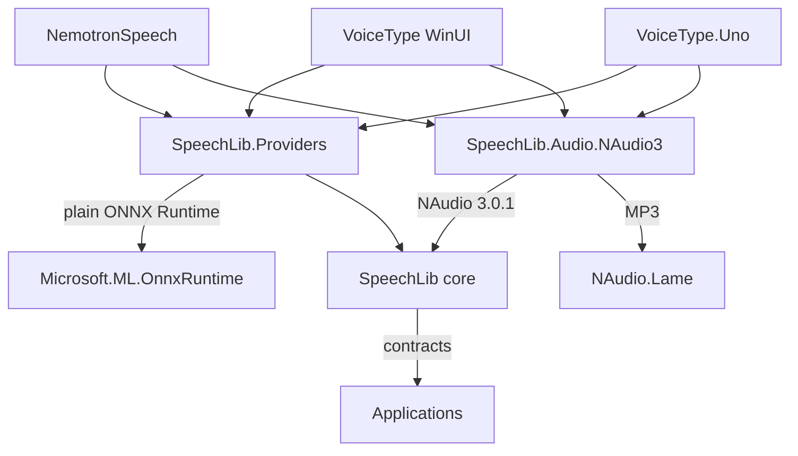

# Nemotron ASR .NET 🎙️

Real-time multilingual speech recognition using [NVIDIA Nemotron 3.5 ASR](https://huggingface.co/nvidia/nemotron-3.5-asr-streaming-multilingual-0.6B) (0.6B params) in C# on plain ONNX Runtime (own streaming RNN-T decoder; ONNX Runtime GenAI is no longer used).

| Feature | Details |
|---------|---------|
| **Languages** | 100+ (auto-detect or BCP-47 code) |
| **Modes** | File, microphone, system loopback, mic+loopback mix |
| **VAD** | Optional Silero input processing; capture and model lifecycle remain independent |
| **Providers** | CPU (default); optional WebGPU plugin execution provider: for Nemotron it runs the encoder on a discrete GPU only, see [docs/research/nemotron-webgpu.md](docs/research/nemotron-webgpu.md) |
| **Architecture** | KISS + SOLID, lock-free audio pipeline |

---

## Solution Structure

```
nemotron-speech-csharp/
├── NemotronSpeech.slnx           # .NET 10 solution file
├── apps/                         # Executable products, each with local source and tests
│   ├── NemotronSpeech/src/       # 🎙️ Nemotron recognizer CLI
│   ├── VoiceType.WinUI/src/      # 🪟 WinUI 3 packaged desktop app
│   └── VoiceType.Uno/            # 🐧 Uno Platform app (Skia desktop: Windows and Linux, plus Android) and its tests
├── libraries/SpeechLib/          # 📚 Speech contracts, audio, recognizers (src/) and their tests (tests/)
├── .github/                      # ⚙️ CI/CD workflows and composite action (see docs/ci.md)
├── tools/                        # 📊 Benchmarks, inspection utilities, and converters
│   └── converters/               # 🐍 Independently extractable model converters
│       ├── NemotronAsr/          #    NeMo → ONNX ASR conversion (Python)
│       └── SortformerStreaming/  #    Streaming diarization state conversion (C#)
├── modules/                      # 🧠 Ready models by module (git-ignored)
│   ├── asr/                      #    ASR models (cpu, cpu-ru-en, qnn, ...)
│   ├── diarization/              #    Sortformer diarization models
│   └── denoise/                  #    DeepFilterNet3 denoise model
├── work/                         # 🛠️ Temp/intermediate conversion artifacts (git-ignored)
└── Test-Audio/                   # 🎵 Test audio files
```

## Projects

| Project | Type | Description |
|---------|------|-------------|
| [**SpeechLib**](libraries/SpeechLib/src/SpeechLib/README.md) | .NET 10 Library | Provider-neutral interfaces, bounded audio queues, capture lifecycle, and `LiveTranscriber` |
| **SpeechLib.Providers** | .NET 10 Library | Recognizers on plain ONNX Runtime (NVIDIA Nemotron, Parakeet TDT, Qwen3-ASR, VibeVoice) and the `RecognizerFactory` that selects them |
| **SpeechLib.Audio.NAudio3** | .NET 10 Library | NAudio 3.0.1 WASAPI capture provider used by the CLI, VoiceType.WinUI and VoiceType.Uno (Windows) |
| [**NemotronSpeech**](apps/NemotronSpeech/src/NemotronSpeech/README.md) | .NET 10 Console App | Command-line front end over `RecognizerFactory` for NVIDIA Nemotron 3.5 ASR and Parakeet TDT (plain ONNX Runtime, CPU). |
| [**VoiceType.WinUI**](apps/VoiceType.WinUI/src/VoiceType.WinUI/README.md) | .NET 10 WinUI 3 MSIX App | Packaged dictation app using NAudio 3, model setup, text injection, session persistence, and local MSIX installation |
| [**VoiceType.Uno**](apps/VoiceType.Uno/README.md) | .NET 10 Uno Platform App | Cross-platform port of the dictation app (Skia desktop on Windows and Linux, Android): global hotkeys, text typed into the focused window, recordings History, live translation |
| **BenchmarkSuite1** | .NET 10 Console App | BenchmarkDotNet suite for CPU threads, VAD, execution mode, RTF, and process CPU measurements |

## Quick Start

### Prerequisites
- [.NET 10 SDK](https://dotnet.microsoft.com/download/dotnet/10.0)
- Windows 10/11
- Microphone

### CPU (any machine)
```powershell
# once after cloning: the LiteRtLmSharp packages that nuget.config maps to the local folder feed (needed before any restore)
pwsh tools/scripts/fetch-litertlmsharp-feed.ps1
dotnet build NemotronSpeech.slnx -c Release
dotnet run --project apps/NemotronSpeech/src/NemotronSpeech -c Release -- --help
```

The apps are started from their own folders: the packaged WinUI app with the scripts described in
[its README](apps/VoiceType.WinUI/src/VoiceType.WinUI/README.md) (`build-dev.ps1`, `install-dev.ps1`), the Uno app as in
[its README](apps/VoiceType.Uno/README.md). The Uno projects are not in `NemotronSpeech.slnx`.

### Continuous integration

`.github/workflows/ci.yml` builds the solution and runs the model-free unit tests (about 2,000 in 9 projects) on Windows and
Linux and runs the no-GenAI guard; the Uno packages and releases have their own workflows. What runs when, how to run the same
checks locally, how to cut a release and what is not covered: [docs/ci.md](docs/ci.md).

> The project is CPU-only: `SpeechLib.Providers` references the plain
> `Microsoft.ML.OnnxRuntime` package. ONNX Runtime GenAI was removed (the
> `tools/scripts/check-no-genai.ps1` check keeps it out). The former
> `-p:GpuArch=CPU|Standard|DML|Blackwell` switch and its CUDA / DirectML packages
> were removed.

## Build Configurations

| Command | Execution provider | ONNX Runtime |
|---------|--------------------|--------------|
| `dotnet build -c Release` | CPU | 1.30.0 |

## Dependencies Graph



The core assembly does not reference NAudio; its only inference dependency is plain ONNX Runtime for the shared Silero VAD filter. Audio providers are Windows-specific; the core contracts can be used on other platforms with an application-supplied `IAudioSource`.

### Audio capture

All Windows heads (CLI, VoiceType.WinUI, VoiceType.Uno) capture through `NAudio3AudioSourceFactory`; the former NAudio 2 provider was removed. Devices are opened in their native WASAPI mix format and converted to the recognizer rate with the anti-aliased `StreamingResampler` from the core library. To use the provider in another application, reference `SpeechLib.Audio.NAudio3`, create an `NAudio3AudioSourceFactory`, and pass its source to `LiveTranscriber.Run`. See [SpeechLib.Audio.NAudio3 README](libraries/SpeechLib/src/SpeechLib.Audio.NAudio3/README.md).

### CPU execution mode

CPU model sessions use a thread-count heuristic, `inter_op_num_threads=1`,
`session.force_spinning_stop=1`, and explicit `ORT_SEQUENTIAL` execution by default.
These settings control ONNX scheduling; they do not eliminate the cost of streaming
inference. VAD is not a replacement for muting capture when the goal is to stop model
work entirely.

## CLI Usage (NemotronSpeech)

```powershell
# Microphone with VAD, Russian
dotnet run --project apps/NemotronSpeech/src/NemotronSpeech -c Release -- "modules/asr/cpu" --mic cpu --language ru --use_vad true

# Audio file
dotnet run --project apps/NemotronSpeech/src/NemotronSpeech -c Release -- "modules/asr/cpu" "audio.wav" cpu --language en

# Audio file with word-level timestamps
dotnet run --project apps/NemotronSpeech/src/NemotronSpeech -c Release -- "modules/asr/cpu" "audio.wav" cpu --word-timestamps

# System audio loopback
dotnet run --project apps/NemotronSpeech/src/NemotronSpeech -c Release -- "modules/asr/cpu" --loopback cpu
```

### Word Timestamps (`--word-timestamps`)

File-mode only. Outputs each word with its `[start → end]` time in seconds:

```
============================================================
  Perhaps he made up to the party afterwards and took her...
============================================================

  Word timings (25 words):
------------------------------------------------------------
  [0.56s -> 1.00s] Perhaps
  [1.00s -> 1.12s] he
  [1.12s -> 1.40s] made
  ...
```

| Aspect | Detail |
|--------|--------|
| **Granularity** | Nemotron: the 80 ms frame of every token, calibrated for the emission lag and snapped to the speech onsets; recognizers without frame times: ~560ms per chunk, refined by token-count weighting |
| **Punctuation** | Merged into preceding word (no standalone `.` or `,` entries) |
| **Language tags** | `<en-US>`, `<de-DE>` etc. filtered from timing output |
| **Time distribution** | Nemotron: from the token frames (`NemotronWordTimer`); fallback: weighted by estimated token count per word |
| **Model** | `SpeechLib/Models/WordTiming.cs` — `Word`, `StartSeconds`, `EndSeconds` |
| **CLI flag** | `--word-timestamps` (ignored in live/mic mode) |

## Model Conversion

See [tools/converters/NemotronAsr/README.md](tools/converters/NemotronAsr/README.md) for Python model conversion (NeMo → ONNX). Available presets:

| Variant | Encoder | Size | Target |
|---------|---------|------|--------|
| `gpu-cuda` | INT8 | ~1021 MB | NVIDIA GPU |
| `cpu` | INT4 | ~757 MB | Any CPU |
| `gpu-dml` | INT8 | ~1021 MB | DirectML GPU |

---

### 📖 Detailed Documentation
- [SpeechLib README](libraries/SpeechLib/src/SpeechLib/README.md) — library architecture & extensibility
- [NemotronSpeech README](apps/NemotronSpeech/src/NemotronSpeech/README.md) — model setup, CLI args
- [VoiceType.WinUI README](apps/VoiceType.WinUI/src/VoiceType.WinUI/README.md) — WinUI build, MSIX packaging, and local installation
- [VoiceType.Uno README](apps/VoiceType.Uno/README.md) — Uno app status, platforms, packaging
- [CI/CD](docs/ci.md) — workflows, tests in CI, releases, Android signing, open decisions

### Language Codes (common)
`en` `ru` `zh` `de` `fr` `es` `ja` `ko` `hi` `ar` `pt` `it` `nl` `pl` `tr` `uk` `sv` `da` `fi` `no` `cs` `hu` `ro` `el` `th` `vi` `he` `auto`

---

## Performance

### CPU INT4/INT8 benchmark

`BenchmarkSuite1` (`NemotronRnntCpuBenchmark`, `NemotronRnntCpuThreadBenchmark`) compares the INT4 / FP32 and
c056 / c112 Nemotron models (`models/asr/nemotron-3.5-asr-streaming-0.6b-onnx-<variant>-cpu`) on `Test-Audio/sample-0.mp3`.
The benchmark reports steady-state real-time factor (RTF) and memory
diagnostics; transcripts are written to the ignored `build/benchmark-results/`
directory for manual WER comparison against a trusted reference.

```powershell
dotnet run --project tools/BenchmarkSuite1 -c Release --no-restore -- --filter "*TranscribeSampleRtf*"
```

Model construction is intentionally outside the timed method, so these results
measure inference throughput rather than startup time. The benchmark also reports
process CPU time and can compare `ORT_SEQUENTIAL` with `ORT_PARALLEL`.

One local CPU INT4 run over 10.1 seconds of audio produced these illustrative values (measured with the former ONNX Runtime GenAI engine; the plain-ONNX-Runtime recognizer that replaced it is slightly cheaper, RTF 0.168 against 0.182 at 4 threads in a back-to-back run):

| Threads | VAD | Execution | RTF | Process CPU |
|---------|-----|-----------|-----|-------------|
| 6 | off | sequential | 0.209 | 31.95% |
| 6 | off | parallel | 0.214 | 31.86% |
| 8 | off | sequential | 0.205 | 44.69% |
| 8 | on | sequential | 0.201 | 42.78% |

Results vary by processor, model build, and audio. VAD may reduce work for suitable
silence segments, but it does not stop capture or guarantee that all inference is
skipped.

---

## Architecture

```
Mic/Loopback ──→ selected NAudio provider ──→ bounded ConcurrentQueue<float[]> (batched)
                                          │
                                          ▼
                              NemotronRnntRecognizer (plain ONNX Runtime)
                                │               │
                         Silero chunk gate   log-mel → Encoder (INT4/FP32, cache-aware)
                                │               │
                                ▼               ▼
                         greedy RNN-T loop ← Decoder + Joiner
                                     │
                                     ▼
                       NemotronVocabulary (detokenize) → Console
```

**Files (SOLID):**

| File | Responsibility |
|------|---------------|
| `Program.cs` | Entry point, DI wiring |
| `AppOptions.cs` | CLI parsing |
| `LanguageMapper.cs` | BCP-47 → lang_id |
| `NemotronRnntRecognizer.cs` | Nemotron streaming recognizer on plain ONNX Runtime (`SpeechLib.Providers/Nemotron`) |
| `WordTiming.cs` | Word + start/end time record |
| `IAudioSourceFactory` | Provider-neutral source construction contract |
| `LiveTranscriber.cs` | Provider-neutral live capture orchestration |
| `Transcriber.cs` | File orchestration and compatibility API |

---

## License

MIT — see [LICENSE](tools/converters/NemotronAsr/LICENSE)
