# VoiceType.Uno — редизайн для мобильных и десктопа

Статус: **реализовано** в ветке `feat/uno-mobile-redesign` (2026-10-12), проверено на desktop и на Huawei P30 Pro (Android 10), см. §10–11.
Область: `apps/VoiceType.Uno` — головы `net10.0-android`, `net10.0-desktop` (Skia),
`net10.0-windows10.0.26100` (WinUI 3).

| Файл | Что это |
|---|---|
| [mockup.html](mockup.html) | Интерактивный макет: главный экран, боковое меню, экран «Модели» (открыть в браузере; меню, запись, режимы и вкладки кликабельны) |
| [frame.html](frame.html) | Обёртка для рендера макета в точном размере viewport |
| [render.ps1](render.ps1) | Рендер скриншотов + автоматическая проверка перекрытий во всех сценариях |
| [layout-check.json](layout-check.json) | Отчёт последней проверки (23 сценария, 0 проблем) |
| [screenshots/](screenshots/) | Скриншоты макета для телефона, планшета и десктопа |
| [uia-layout-check.ps1](uia-layout-check.ps1) | Те же правила проверки на **запущенном** приложении (desktop-голова) через UI Automation |
| [app-screenshots.ps1](app-screenshots.ps1), [app-screenshots/](app-screenshots/) | Скриншоты запущенного приложения: главный экран, меню, «Модели» при 360×800, 800×360, 1280×800 |

---

## 1. Задача

1. Вверху главного экрана — только кнопка вызова **бокового меню**.
2. В боковом меню — **смена режимов работы** и вызов **настроек** (плюс модели, загрузки, справка).
3. Внизу по центру — кнопка **«Запись»**.
4. Все кнопки доступны на телефоне и на десктопе **без перекрытий**.
5. Запись **непрерывная**: нажал — идёт распознавание, пока не нажмёшь снова; кнопку держать не нужно.
6. **Менеджер загрузок моделей** — часть дизайна (модели распознавания, модель перевода, очередь загрузок).

## 2. Что не так сейчас

[MainPage.xaml](../../../apps/VoiceType.Uno/src/VoiceType.Uno/MainPage.xaml):

| Проблема | Где | Последствие на телефоне |
|---|---|---|
| Верхняя строка из 7 элементов (статус, 2 ComboBox, «Translate all», Models, Downloads, Help, Settings) в горизонтальном `ScrollViewer` | строки 23–68 | Настройки и справка уезжают за правый край; пользователь не знает, что строку надо листать |
| Нижняя строка из 6 кнопок (Start, Mute, Copy, Inject text, Translate, Manual input) в горизонтальном `ScrollViewer` со скрытой полосой прокрутки | строки 184–216 | Кнопка записи — первая слева, а не по центру; режимы прячутся за краем без индикации |
| Режимы (`Inject text`, `Translate`, `Manual input`) и действия (`Mute`, `Copy`) выглядят одинаково — `Button`/`ToggleButton` подряд | строки 190–215 | Непонятно, что включено; легко включить режим случайно |
| Корневой `Grid Padding="16,16,16,8"` без безопасных зон | строка 7 | На Android 15+ (edge-to-edge принудительно) контент заходит под статус-бар и жестовую панель |
| `WindowSoftInputMode = SoftInput.AdjustNothing` | [MainActivity.Android.cs](../../../apps/VoiceType.Uno/src/VoiceType.Uno/Platforms/Android/MainActivity.Android.cs) | В режиме ручного ввода клавиатура перекрывает поле и нижние кнопки — окно не сжимается, а `SafeArea SoftInput` не используется |

## 3. Работа с Uno Platform + Claude Code

По [инструкции Uno](https://platform.uno/docs/articles/get-started-ai-claude.html?tabs=windows):

```powershell
dotnet tool update -g uno.check
uno-check --target desktop --target android --target windows

# MCP: документация Uno и управление запущенным приложением
claude mcp add --scope user --transport http uno https://mcp.platform.uno/v1
claude mcp add --scope user --transport stdio "uno-app" -- dotnet dnx -y uno.devserver --mcp-app
```

После регистрации в новой сессии Claude Code проверить командой `/mcp`.

- `uno` — поиск по документации Uno (контролы, Toolkit, платформенные особенности).
- `uno-app` — подключается к запущенному приложению через DevServer: скриншоты,
  визуальное дерево, взаимодействие с элементами. **Загружается только если Claude
  запущен в папке с Uno-приложением** — запускать из `apps/VoiceType.Uno/src`
  (там лежит `global.json` с `Uno.Sdk 6.7.30`).

**Что было доступно при подготовке дизайна.** В этой сессии MCP-серверы Uno не были
зарегистрированы (`claude mcp list` их не показывает), а регистрация вступает в силу
только в новой сессии. Поэтому:

- документация Uno Toolkit (`SafeArea`, `DrawerFlyoutPresenter`, `NavigationBar`)
  прочитана напрямую с platform.uno;
- перекрытия проверены на HTML-макете, который повторяет предлагаемую XAML-разметку
  строка в строку (см. §6). Это проверка **дизайна**, а не работающего приложения.
  После реализации проверку нужно повторить на приложении через `uno-app` (§8, шаг 7).

## 4. Что можно сделать: выбор контролов

Все варианты доступны в текущем стеке (`Uno.Sdk 6.7.30`, `UnoFeatures`: `Hosting; Mvvm; SkiaRenderer; Toolkit`).

| Задача | Вариант | Решение |
|---|---|---|
| Боковое меню | **`SplitView`**, `DisplayMode="Overlay"`, `IsPaneOpen` + light dismiss | **Выбрано.** Встроенный WinUI-контрол, одинаково работает на WinUI, Skia и Android, не требует ресурсов Toolkit |
| | `NavigationView PaneDisplayMode="LeftMinimal"` | Отклонено: рассчитан на навигацию между страницами (`MenuItems` = страницы), а у нас переключатели режимов и диалоги; тянет свой заголовок и кнопку «назад» |
| | `utu:DrawerFlyoutPresenter` (Uno Toolkit) | Возможная доработка: даёт свайп от края. Требует `<ToolkitResources/>` в `App.xaml` (сейчас не подключены) и обхода бага WinUI [microsoft-ui-xaml#6388](https://github.com/microsoft/microsoft-ui-xaml/issues/6388) для attached-сеттеров на Windows |
| Безопасные зоны | **`utu:SafeArea.Insets`** (attached property) | **Выбрано.** `Top` для верхней панели, `Bottom` для нижней, `Left,Right` для корня, `SoftInput` для экранной клавиатуры. Attached-свойства работают без `ToolkitResources` |
| Адаптивность | `VisualStateManager` + `AdaptiveTrigger` (MinWindowWidth/MinWindowHeight) | **Выбрано** для перестройки транскрипт/перевод; `utu:Responsive` (уже используется) — для отдельных размеров |
| Верхняя панель | `utu:NavigationBar` | Отклонено: на Android по умолчанию нативный `Toolbar` с ограниченной кастомизацией (нельзя положить индикатор статуса справа произвольной разметкой). Достаточно `Grid` |
| Иконки | `SymbolIcon` / `FontIcon` | Uno.Sdk подключает шрифт `Uno.Fonts.Fluent` (2.6.1 в `project.assets.json`), поэтому `Symbol="GlobalNavigationButton"`, `Microphone`, `Stop`, `Mute`, `Copy`, `Setting`, `Help`, `Download` рендерятся одинаково на всех головах |

## 5. Дизайн

### 5.1 Структура экрана

```
┌──────────────────────────────────────────┐ ← SafeArea Top
│ [≡]  VoiceType                 ● Ready   │  Row 0  верхняя панель, 56 px (48 на низких экранах)
│      Parakeet TDT INT4 · Auto · → RU     │         подзаголовок = сводка активных режимов
├──────────────────────────────────────────┤
│ ⓘ ASR model is not available… [Download] │  Row 1  баннеры / прогресс загрузки (Collapsed, если нет)
├──────────────────────────────────────────┤
│ ┌ Transcript ─────────────────── [🗑] ┐  │  Row 2  контент (*)
│ │ The meeting starts at ten…          │  │         транскрипт
│ └─────────────────────────────────────┘  │
│ ┌ Translation  → RU ▾ ─────────── [文A]┐ │         перевод (только при включённом переводе)
│ │ Встреча начнётся в десять…          │  │
│ └─────────────────────────────────────┘  │
├──────────────────────────────────────────┤
│         (🎙̸)     (  ●  )     (⧉)          │  Row 3  панель команд: Grid "*,Auto,*"
│                Tap to dictate            │         Mute · ЗАПИСЬ · Copy
└──────────────────────────────────────────┘ ← SafeArea Bottom + SoftInput
```

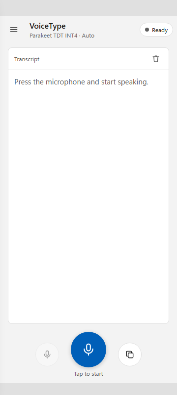 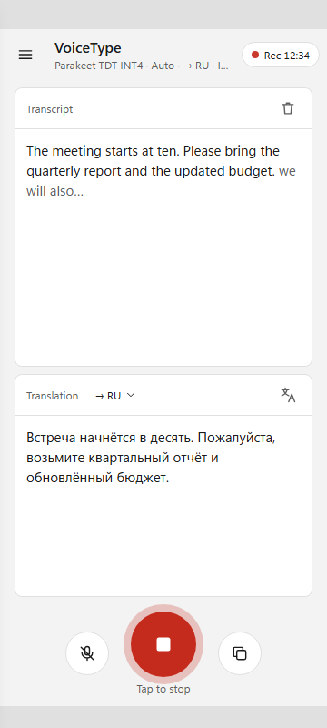 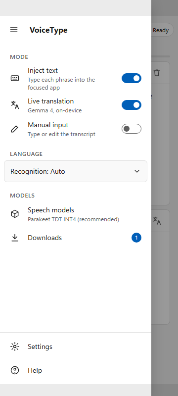

### 5.2 Верхняя панель

| Элемент | Размер | Поведение |
|---|---|---|
| Кнопка меню `≡` | 48×48 | Открывает `SplitView`. `AutomationProperties.Name="Open menu"` |
| Заголовок + подзаголовок | `*` | Подзаголовок — сводка: модель · язык · `→ RU` при переводе · `Inject` при вставке текста. Обрезается многоточием |
| Индикатор состояния | авто | `Ready` / `Rec 12:34` (красная пульсирующая точка + длительность сессии) / `Muted 12:34` (жёлтая) / `Loading model…` / `Downloading…`. `AutomationProperties.LiveSetting="Polite"` (как сейчас у `StatusText`) |

Кнопок, кроме меню, вверху нет — это главное требование и главный источник прежних перекрытий.

### 5.3 Боковое меню (SplitView pane)

Ширина `min(320, 85 % ширины окна)`, поверх контента с затемнением; закрывается тапом
по затемнению, кнопкой `≡` в меню, клавишей Esc/«Назад».

| Секция | Элемент | Контрол | Привязка (существующая) |
|---|---|---|---|
| **Mode** | Inject text — «Type each phrase into the focused app» | `ToggleSwitch` в строке 48 px | `IsTextInjectionEnabled` |
| | Live translation — «Gemma 4, on-device» | `ToggleSwitch` | `IsTranslationEnabled` |
| | Manual input — «Type or edit the transcript» | `ToggleSwitch` | `IsManualInputEnabled` |
| **Language** | Recognition: Auto ▾ | `ComboBox`, растянут | `SelectedLanguage` / `LanguageOptions` |
| **Models** | Speech models (подпись — активная модель) | кнопка-строка | открывает экран «Модели», вкладка Speech (§5.8) |
| | Downloads (бейдж с числом активных загрузок) | кнопка-строка | открывает экран «Модели», вкладка Downloads; `IsQueueActive` |
| **Низ меню** (прибит к низу) | Settings | кнопка-строка | `Settings_Click` |
| | Help | кнопка-строка | `Help_Click` |

Правила:

- Режимы — переключатели, а не кнопки: состояние видно сразу.
- Вызов диалога из меню **сначала закрывает меню**, затем открывает `ContentDialog`
  (диалог должен быть один на `XamlRoot`, а затемнение `SplitView` не должно оставаться под диалогом).
- Средняя часть меню прокручивается (`ScrollViewer`), «Settings/Help» всегда видны —
  проверено на 320×568 и в горизонтальной ориентации 800×360.
- Глобальные хоткеи Windows/Linux (запись, mute, вставка текста) работают как раньше;
  переключатели в меню лишь отражают текущее состояние.

### 5.4 Контент

- **Транскрипт** — карточка с заголовком `Transcript` и кнопкой очистки (44×44).
  В режиме ручного ввода заголовок `Transcript · editing` и акцентная рамка.
- **Перевод** — карточка с выбором целевого языка в заголовке (`→ RU ▾`, бывший ComboBox
  из верхней строки) и кнопкой `Translate all` (иконка, бывшая кнопка из верхней строки).
- Перетаскиваемый разделитель (`Divider_Pointer*`) **убирается**: на телефоне он мешает
  прокрутке и плохо попадается пальцем. Высоты задаются пропорциями (см. §5.6).

### 5.5 Панель команд (низ)

`Grid` с колонками `*, Auto, *` — запись **математически по центру** при любой ширине,
боковые кнопки прижаты к ней (`HorizontalAlignment` Right/Left, отступ 24 px).

| Элемент | Размер | Поведение |
|---|---|---|
| Mute | 48×48, круглая | Активна только во время записи (`IsEnabled=IsRecording`), иконка `Mute` |
| **Запись** | **72×72**, круглая, акцентная (56×56 на низких экранах и при открытой клавиатуре) | Переключатель, не push-to-talk (§5.7). Idle: иконка микрофона, акцентный цвет. Recording: иконка «стоп», красный фон + кольцо. `Command=ToggleCommand`, `AutomationProperties.Name` = `RecordButtonText` |
| Подпись | 12 px | `Tap to start` / `Tap to stop` / `Muted · tap to resume` / `Loading model…`. Скрыта на низких экранах |
| Copy | 48×48, круглая | `CopyCommand` |

Кольцо записи рисуется **внутри** габарита 72×72 (ободок `Border`, а не тень за пределами),
чтобы не наезжать на карточки.

### 5.6 Адаптивные состояния

| Состояние | Условие | Изменения |
|---|---|---|
| `Narrow` (по умолчанию) | ширина < 840 | Транскрипт и перевод друг под другом, высоты `1*` / `0.8*`, минимум 96 px |
| `Wide` | ширина ≥ 840 | Транскрипт и перевод **рядом** (две колонки); отступы 24 px |
| `Short` | высота < 480 (телефон горизонтально) | Верхняя панель 48 px, запись 56 px без подписи, при ширине ≥ 560 — перевод рядом |
| `Compact` | высота ≤ 520 и ширина < 560 (разделённый экран Android) | Транскрипт и перевод в одной ячейке; заголовок карточки становится переключателем `Transcript | Translation`; баннер в одну строку, прогресс — только полоса |
| `Keyboard` | открыта экранная клавиатура (`SafeArea SoftInput`) | Нижняя панель компактная; карточка перевода сворачивается до заголовка, чтобы редактируемый транскрипт сохранил место |

Меню во всех состояниях — `Overlay`. На широком десктопе можно позже включить
`DisplayMode="Inline"` (меню закреплено), но это не требуется задачей.

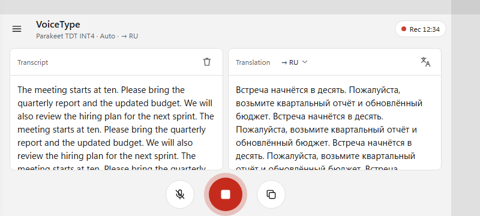

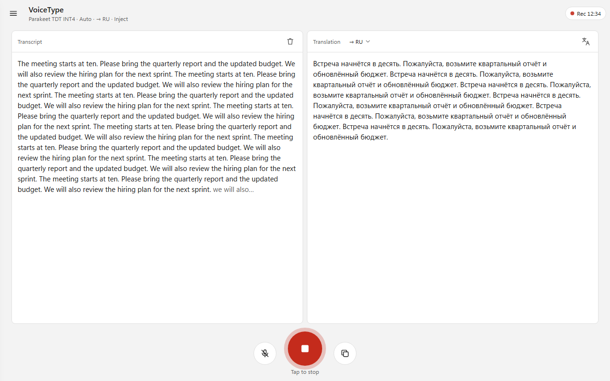

### 5.7 Непрерывная запись

Запись — **переключатель**: одно нажатие запускает распознавание, следующее останавливает.
Держать кнопку не нужно, автоостановки по тишине или таймеру нет.

**Что уже работает так.** `ToggleCommand` ([MainViewModel.cs](../../../apps/VoiceType.Uno/src/VoiceType.Uno/Presentation/MainViewModel.cs),
`ToggleAsync`) — переключатель: при записи вызывает `_recognition.Stop()`, иначе `StartAsync`.
`RecognitionService.Stop()` вызывается только этой командой, выгрузкой модели и при ошибке.
В паузах между фразами Parakeet пропускает работу энкодера (silence gate), поэтому долгая
сессия с молчанием почти не нагружает CPU. Поворот экрана не прерывает запись
(`ConfigurationChanges = AllConfigChanges` в `MainActivity`).

**Чего не хватает для записи разговора на телефоне.** На Android 9+ приложение в фоне не получает
звук с микрофона: при блокировке экрана или переходе в другое приложение `AudioRecord` начинает
отдавать тишину, распознавание «молча» останавливается. Сейчас в манифесте есть только
`RECORD_AUDIO`, `INTERNET` и `POST_NOTIFICATIONS`, foreground service нет.

| Требование | Решение |
|---|---|
| Запись идёт при выключенном экране и в другом приложении | Android foreground service `foregroundServiceType="microphone"`, запускается в `ToggleAsync` при старте записи (пока приложение на экране — так требует Android 14+), останавливается при `Stop`. Разрешения `FOREGROUND_SERVICE`, `FOREGROUND_SERVICE_MICROPHONE` |
| Пользователь видит, что микрофон включён | Постоянное уведомление `VoiceType · Recording 12:34` с действиями **Mute** и **Stop**; тап по уведомлению возвращает в приложение |
| Процессор не засыпает при выключенном экране | Partial wake lock на время записи (в составе сервиса) |
| Понятно, что запись продолжается сама | Таймер сессии в индикаторе состояния, кольцо вокруг кнопки, подпись `Tap to stop` |
| Длинная сессия не тормозит интерфейс | Транскрипт растёт неограниченно; при реализации проверить `TextBox` на 1–2 часах текста, при необходимости — виртуализированный список абзацев |
| Звонок / другое приложение забрало микрофон | Показать `Microphone in use by another app` в индикаторе и в уведомлении; запись не останавливать — продолжить, когда микрофон освободится |

Десктоп (WASAPI на Windows, PulseAudio на Linux) уже пишет при свёрнутом окне — изменений не требуется.

```
Android-уведомление (ongoing, канал «Recording»)
┌──────────────────────────────────────────────┐
│ 🎙 VoiceType · Recording 12:34                │
│ Parakeet TDT INT4 · Auto · → RU               │
│                         [ Mute ]   [ Stop ]   │
└──────────────────────────────────────────────┘
```

### 5.8 Экран «Модели» (менеджер загрузок)

Сейчас это два отдельных `ContentDialog`: **Speech models** ([ModelManagerDialog.xaml](../../../apps/VoiceType.Uno/src/VoiceType.Uno/Presentation/ModelManagerDialog.xaml),
`MaxHeight="640"`) и **Model downloads** ([DownloadsView.xaml](../../../apps/VoiceType.Uno/src/VoiceType.Uno/DownloadsView.xaml) в диалоге).
На телефоне диалог выше экрана, а у карточки модели 3 кнопки в ряд плюс 5 чипов в ряд —
на 320 px они не помещаются. Модели перевода в менеджере нет совсем: её можно скачать только
из баннера на главном экране.

**Решение:** один полноэкранный экран **«Модели»** (навигация `Frame.Navigate`, кнопка «Назад»
и системный жест «Назад» возвращают на главный экран) с тремя вкладками:

| Вкладка | Содержимое | Источник данных |
|---|---|---|
| **Speech** | Подсказка «Which model should I download?» → карточки моделей каталога | `ModelManagerViewModel.Cards`, `RecommendationText` |
| **Translation** | Карточка Gemma 4 E2B (LiteRT-LM): статус, Download / Cancel / Delete | `TranslationModelInfo`, `EnqueueTranslationModelDownload` |
| **Downloads · N** | Сводный прогресс очереди + «Clear finished», затем задания: Downloading / Queued / Failed / Completed | `DownloadsViewModel.Items`, `AggregateText` |

Подзаголовок экрана: `2 installed · 1.4 GB used`.

**Карточка модели** (одна колонка на телефоне, две — при ширине ≥ 840):

```
┌ Parakeet TDT 0.6B v3 ───────────────────────┐
│ [INT4] [★ Recommended] [● In use]            │  чипы переносятся (wrap), не в ряд
│ Recommended — best accuracy, live text       │
│ Accuracy       Speed            Download     │  три колонки фиксированной ширины
│ WER 8.1%       ≈5.4× real-time  697 MB       │
│ ━━━━━━━━━━━━━━━━━━━──────────── 42% · 3 MB/s │  только во время загрузки
│ Installed                     [ Use ]  [⋯]   │  одно основное действие + меню
└──────────────────────────────────────────────┘
```

- Одно основное действие по состоянию: `Download` → `Cancel` (во время загрузки) → `Use` → `In use` (неактивна).
- Редкие действия — в меню `⋯`: `Re-download`, `Delete`, `Show details` (WER по языкам, задержка, сценарий).
- Активная модель выделена рамкой акцентного цвета.
- Задание с ошибкой: `Retry` (докачка — `ModelDownloadManager` поддерживает resume) и `Remove`.
- Точка входа из баннера «ASR model is not available» на главном экране — кнопка `Download` ставит
  рекомендованную модель в очередь (как сейчас), а тап по тексту баннера открывает вкладку Downloads.

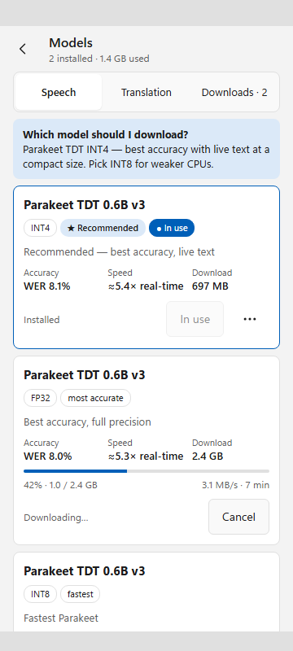 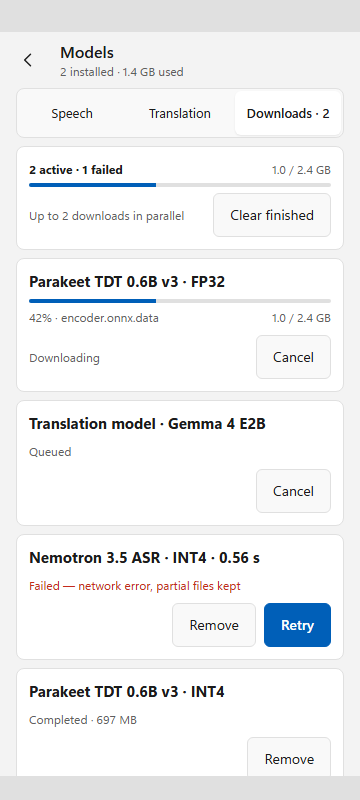 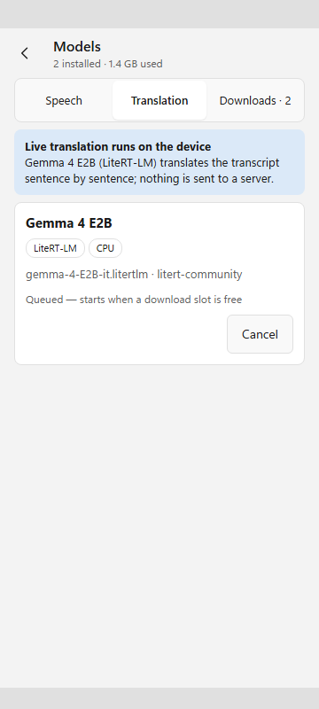

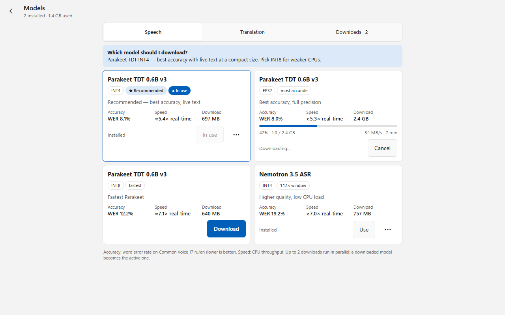

## 6. Проверка перекрытий

### 6.1 Метод

`render.ps1` открывает `mockup.html` в headless Edge с **точным** размером viewport,
имитирует системные панели (`top`/`bottom`/`left`/`right` — статус-бар, жестовая или
3-кнопочная панель навигации) и экранную клавиатуру (`kb`), делает скриншот и проверяет
каждый интерактивный элемент (`[data-hit]`):

1. целиком внутри безопасной области (окно минус системные панели и клавиатура);
2. область касания ≥ 44×44 px (WCAG 2.5.5; Fluent/Material рекомендуют 44–48);
3. не пересекается ни с одним другим интерактивным элементом (для элементов в
   прокручиваемых панелях — по видимой части);
4. кнопка записи по центру безопасной области (|dx| ≤ 1 px);
5. карточки не заходят под верхнюю/нижнюю панели, у транскрипта ≥ 96 px, у текста ≥ 40 px.

Проверяется только верхний интерактивный слой: экран «Модели» → боковое меню → главный экран.

Проверка сама проверена: на заведомо неподходящем окне 320×420 до введения состояния
`Compact` она нашла 4 пересечения (`target`↔`mute`, `target`↔`record`, `translate-all`↔`copy`,
карточка перевода под панелью команд).

```powershell
pwsh docs/design/voicetype-uno-mobile/render.ps1   # код выхода 1 при любой проблеме
```

### 6.2 Результат (23/23 OK)

| Сценарий | Viewport | Вставки | Состояние |
|---|---|---|---|
| phone-idle | 360×800 | статус 32, жесты 24 | ожидание |
| phone-recording-translate | 360×800 | 32 / 24 | запись, перевод, вставка текста |
| phone-drawer | 360×800 | 32 / 24 | меню открыто, идёт загрузка |
| phone-banner-download | 360×800 | 32 / 3-кнопочная 48 | баннер «нет модели» + прогресс |
| phone-manual-keyboard | 360×800 | 32 / 24, клавиатура 320 | ручной ввод |
| phone-small-320 | 320×568 | 24 / 48 | запись на паузе, перевод, баннер |
| phone-small-keyboard | 320×568 | 24 / 48, клавиатура 260 | ручной ввод + перевод |
| phone-small-drawer | 320×568 | 24 / 48 | меню (средняя часть прокручивается) |
| phone-split-screen | 320×420 | 24 / 48 | разделённый экран, баннер, загрузка, запись |
| phone-split-screen-tr | 320×420 | 24 / 48 | то же, вкладка перевода |
| phone-landscape | 800×360 | 24 / справа 48 | запись, перевод, длинный текст |
| phone-landscape-drawer | 800×360 | 24 / справа 48 | меню |
| phone-models-speech | 360×800 | 32 / 24 | «Модели», вкладка Speech, одна загрузка |
| phone-models-translation | 360×800 | 32 / 24 | «Модели», вкладка Translation |
| phone-models-downloads | 360×800 | 32 / 24 | «Модели», очередь: загрузка, ожидание, ошибка, готово |
| phone-small-models | 320×568 | 24 / 48 | «Модели» на маленьком экране |
| phone-landscape-models | 800×360 | 24 / справа 48 | «Модели», горизонтально |
| tablet-portrait | 800×1280 | 24 / 48 | запись, перевод |
| desktop-recording | 1280×800 | — | запись, перевод (две колонки) |
| desktop-drawer | 1280×800 | — | меню |
| desktop-models | 1280×800 | — | «Модели», карточки в две колонки |
| desktop-min-window | 480×560 | — | минимальное окно, баннер, загрузка |
| desktop-dark | 1280×800 | — | тёмная тема |

Подробности — [layout-check.json](layout-check.json).

### 6.3 Что проверка нашла и как это учтено в дизайне

| Находка | Решение в дизайне |
|---|---|
| Свёрнутый блок сдвигал строки сетки | В XAML каждому элементу явный `Grid.Row` (свёрнутая строка `Auto` схлопывается, остальные не сдвигаются) |
| Клавиатура на 320×568 сжимала перевод до нечитаемой полосы | Состояние `Keyboard`: перевод сворачивается до заголовка, панель команд компактная |
| На разделённом экране 320×420 две карточки не помещались — кнопки заголовка перевода наезжали на панель команд | Состояние `Compact`: одна ячейка + переключатель в заголовке карточки, баннер в одну строку |

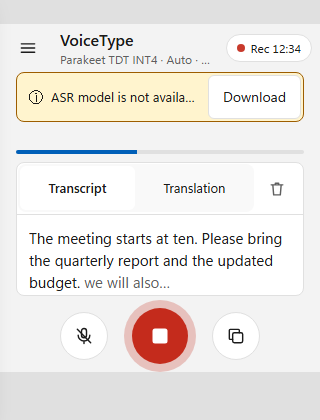 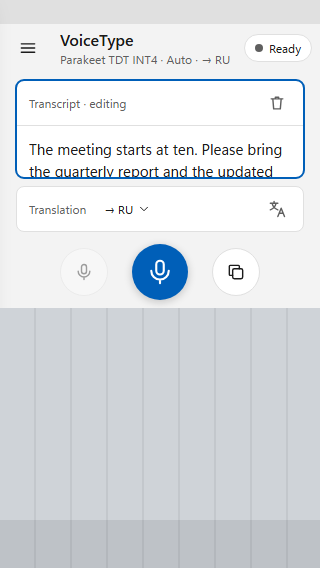 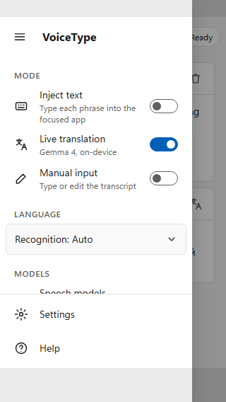

## 7. Эскиз XAML

Эскиз для реализации, **не компилировался** — имена свойств совпадают с текущим
`MainViewModel`, новые перечислены в таблице ниже.

```xml
<Page ... xmlns:utu="using:Uno.Toolkit.UI">
  <!-- IsMenuOpen, ModeSummary, RecordSymbol, RecordCaption — новые члены ViewModel -->
  <SplitView x:Name="Shell" DisplayMode="Overlay" OpenPaneLength="320"
             IsPaneOpen="{x:Bind ViewModel.IsMenuOpen, Mode=TwoWay}"
             PaneBackground="{ThemeResource LayerFillColorDefaultBrush}">
    <SplitView.Pane>
      <Grid utu:SafeArea.Insets="Top,Bottom,Left" RowDefinitions="Auto,*,Auto">
        <!-- ≡ VoiceType -->
        <ScrollViewer Grid.Row="1">
          <StackPanel Padding="8,0">
            <TextBlock Text="MODE" Style="{StaticResource CaptionTextBlockStyle}" Margin="12,16,12,4" />
            <ToggleSwitch Header="Inject text" IsOn="{x:Bind ViewModel.IsTextInjectionEnabled, Mode=TwoWay}" />
            <ToggleSwitch Header="Live translation" IsOn="{x:Bind ViewModel.IsTranslationEnabled, Mode=TwoWay}" />
            <ToggleSwitch Header="Manual input" IsOn="{x:Bind ViewModel.IsManualInputEnabled, Mode=TwoWay}" />
            <!-- LANGUAGE: ComboBox SelectedLanguage; MODELS: Speech models / Downloads -->
          </StackPanel>
        </ScrollViewer>
        <StackPanel Grid.Row="2"> <!-- Settings / Help, прибиты к низу --> </StackPanel>
      </Grid>
    </SplitView.Pane>

    <Grid utu:SafeArea.Insets="Left,Right">
      <Grid.RowDefinitions>
        <RowDefinition Height="Auto" />  <!-- 0 app bar -->
        <RowDefinition Height="Auto" />  <!-- 1 banners -->
        <RowDefinition Height="*" />     <!-- 2 content -->
        <RowDefinition Height="Auto" />  <!-- 3 command bar -->
      </Grid.RowDefinitions>

      <Grid Grid.Row="0" utu:SafeArea.Insets="Top" ColumnDefinitions="48,*,Auto" MinHeight="56">
        <Button Width="48" Height="48" Click="Menu_Click" AutomationProperties.Name="Open menu">
          <SymbolIcon Symbol="GlobalNavigationButton" />
        </Button>
        <!-- Title + ViewModel.ModeSummary; state pill: RecordingIndicator -->
      </Grid>

      <!-- Row 1: существующие баннеры и прогресс очереди, Grid.Row="1" -->
      <!-- Row 2: карточки Transcript / Translation; VisualStates Narrow/Wide/Short/Compact/Keyboard -->

      <Grid Grid.Row="3" utu:SafeArea.Insets="Bottom,SoftInput"
            ColumnDefinitions="*,Auto,*" ColumnSpacing="24" Padding="16,8,16,12">
        <Button Grid.Column="0" HorizontalAlignment="Right" Width="48" Height="48" CornerRadius="24"
                Command="{x:Bind ViewModel.ToggleMuteCommand}"
                IsEnabled="{x:Bind ViewModel.IsRecording, Mode=OneWay}"
                AutomationProperties.Name="Mute microphone">
          <SymbolIcon Symbol="Mute" />
        </Button>
        <StackPanel Grid.Column="1" Spacing="4">
          <Button x:Name="RecordButton" Width="72" Height="72" CornerRadius="36"
                  Style="{StaticResource AccentButtonStyle}"
                  Command="{x:Bind ViewModel.ToggleCommand}"
                  AutomationProperties.Name="{x:Bind ViewModel.RecordButtonText, Mode=OneWay}">
            <!-- RecordSymbol: Microphone / Stop -->
            <SymbolIcon Symbol="{x:Bind ViewModel.RecordSymbol, Mode=OneWay}" />
          </Button>
          <TextBlock x:Name="RecordCaption" Text="{x:Bind ViewModel.RecordCaption, Mode=OneWay}"
                     HorizontalAlignment="Center" FontSize="12" Opacity="0.7" />
        </StackPanel>
        <Button Grid.Column="2" HorizontalAlignment="Left" Width="48" Height="48" CornerRadius="24"
                Command="{x:Bind ViewModel.CopyCommand}" AutomationProperties.Name="Copy transcript">
          <SymbolIcon Symbol="Copy" />
        </Button>
      </Grid>
    </Grid>
  </SplitView>
</Page>
```

Новые члены ViewModel и где им место:

| Член | Где | Тест |
|---|---|---|
| `ModeSummary` (подзаголовок) | форматтер `ModeSummaryFormatter` в `VoiceType.Uno.Core`, `MainViewModel` только проецирует | unit-тест в `VoiceType.Uno.Tests` |
| `RecordCaption`, `RecordSymbol` | рядом с `RecordButtonText` (одни и те же входы: `IsModelDownloading`, `IsModelLoading`, `IsRecording`, `IsCaptureMuted`); логику — в Core | unit-тест |
| `IsMenuOpen` | `MainViewModel` или code-behind `MainPage` | — |

## 8. План реализации

1. **App.xaml / Android.** Убедиться, что `SafeArea` получает реальные вставки на Android
   (edge-to-edge); `WindowSoftInputMode` оставить `AdjustNothing` — клавиатуру
   отрабатывает `SafeArea SoftInput` на панели команд.
2. **MainPage.xaml:** обернуть в `SplitView`, собрать 4 строки (§7), перенести элементы
   верхней строки в меню и в заголовок карточки перевода, удалить горизонтальные `ScrollViewer`
   и разделитель вместе с `Divider_Pointer*`/`UpdateTranslationRowHeight` в code-behind.
3. **Меню:** обработчики `Settings_Click`/`Help_Click` сначала закрывают панель, затем
   показывают диалог; «Speech models» и «Downloads» закрывают панель и переходят на экран «Модели».
4. **Экран «Модели»:** новая страница `ModelsPage` с вкладками (`SelectorBar` или сегментированный
   `RadioButtons`) поверх существующих `ModelManagerViewModel` и `DownloadsViewModel`; карточка с
   одним основным действием и меню `⋯`; вкладка Translation над `TranslationModelInfo`.
   `ModelManagerDialog` и диалог загрузок удаляются.
5. **Непрерывная запись на Android:** foreground service с типом `microphone`, уведомление
   с Mute/Stop, wake lock; таймер сессии в `MainViewModel` (форматирование — в Core, с тестом).
6. **ViewModel/Core:** `ModeSummaryFormatter`, `RecordCaption`, `RecordSymbol` + тесты.
7. **VisualStateManager:** состояния `Narrow`/`Wide`/`Short`/`Compact` через `AdaptiveTrigger`;
   `Keyboard` — по событию `InputPane.Showing/Hiding`.
8. **Диалоги:** `SettingsDialog` (`MaxHeight="620"`) и `HelpDialog` (`MaxHeight="560"`)
   на телефоне 320×568 выше экрана — заменить фиксированный `MaxHeight` на
   ограничение по высоте окна. Отдельная задача, в этот редизайн не входит.
9. **Проверка на приложении:** `dotnet test apps/VoiceType.Uno/tests/VoiceType.Uno.Tests/VoiceType.Uno.Tests.csproj`;
   сборка трёх голов; запуск desktop-головы с окнами 360×800, 320×568, 800×360, 1280×800 и
   Android-эмулятора (3-кнопочная и жестовая навигация, клавиатура в ручном вводе).
   С MCP `uno-app` — скриншоты и обход визуального дерева: те же 5 правил из §6.1
   (границы, 44×44, пересечения, центр записи, высота карточек). Непрерывная запись:
   30 минут разговора на телефоне с выключенным экраном и переключением в другое приложение —
   транскрипт без пропусков, уведомление видно, Stop из уведомления останавливает запись.

### Критерии приёмки

- [ ] Вверху только кнопка меню и индикатор состояния.
- [ ] Меню содержит 3 переключателя режимов, язык, модели, загрузки, настройки, справку.
- [ ] Запись — по центру снизу, 72 px (56 px на низких экранах), над жестовой панелью и клавиатурой.
- [ ] Запись запускается одним нажатием и идёт, пока её не остановят (кнопкой, из уведомления, хоткеем).
- [ ] На Android запись продолжается при выключенном экране и в другом приложении; видно уведомление.
- [ ] Экран «Модели»: вкладки Speech / Translation / Downloads; модель перевода скачивается оттуда.
- [ ] Ни одной горизонтальной прокрутки на главном экране и на экране «Модели».
- [ ] На 320×568, 360×800, 800×360, 1280×800 все кнопки видны, ≥ 44×44, без пересечений.
- [ ] Хоткеи Windows/Linux, вставка текста и перевод работают как раньше.

## 9. Риски

| Риск | Смягчение |
|---|---|
| `SafeArea` на голове Skia Android может отдавать нулевые вставки в отдельных версиях Uno | Проверить на эмуляторе Android 15; запасной вариант — `ApplicationView.VisibleBounds` вручную |
| `SplitView` light dismiss и кнопка «Назад» Android | Обработать `SystemNavigationManager.BackRequested`: сначала закрыть меню |
| Кольцо записи (тень) выходит за габарит | Рисовать кольцо `Border` внутри 72×72 |
| Android 14+ запрещает запускать foreground service с микрофоном из фона | Сервис стартует строго в обработчике нажатия Record, пока приложение на экране |
| Google Play требует обоснование типа `microphone` для foreground service | Описать сценарий «диктовка/запись разговора, начатая пользователем» в карточке приложения |
| Пользователи привыкли к кнопкам режимов внизу | Подзаголовок верхней панели показывает активные режимы; справка (`HelpDialog`) обновляется под новый экран |

## 10. Реализация

Сделано тремя параллельными агентами в изолированных worktree, затем сведено в ветку
`feat/uno-mobile-redesign`:

| Часть | Файлы |
|---|---|
| Главный экран | `MainPage.xaml(.cs)` (SplitView, 4 строки, SafeArea, адаптивные состояния), `MainViewModel.cs` (таймер сессии, `RecordSymbol`, `RecordCaption`, `StatePillText`, `ModeSummary`, `ClearCommand`, keep-alive), `HelpDialog.xaml`; Core: `MainLayout`, `ModeSummaryFormatter`, `RecordingStatusFormatter`, `TranscriptCoordinator.Clear` |
| Экран «Модели» | `Presentation/ModelsPage.xaml(.cs)`, `TranslationModelCardViewModel.cs`, `Controls/ChipWrapPanel.cs`, `Controls/CardColumnsPanel.cs`; доработаны `ModelManagerViewModel`, `ModelCardViewModel`, `DownloadsViewModel`; Core: `ModelsPageFormatter`, `ModelStorage`. Удалены `ModelManagerDialog` и `DownloadsView` |
| Запись в фоне (Android) | `Platforms/Android/RecordingService.cs` (foreground service `microphone`, уведомление Mute/Stop, wake lock), `AndroidRecordingKeepAlive.cs`, `ic_stat_recording.xml`, разрешения в `AndroidManifest.xml`; контракт `Services/Platform/IRecordingKeepAlive.cs` (Null-реализация на десктопе) |

Отличия от дизайна:
- адаптивные состояния вычисляются в коде (`MainLayout.Compute`, покрыт тестами), а не через `AdaptiveTrigger` — сочетания ширины и высоты так проще и проверяемо;
- вкладки «Моделей» — `RadioButton` в сегментированном стиле (вместо `SelectorBar`);
- «Translate all» — иконка `Globe` (в `Symbol` нет иконки перевода);
- текст про параллельные загрузки — «Several downloads run in parallel»: менеджер создаётся с лимитом 3, а не 2;
- индикатор «микрофон занят другим приложением» не реализован — нет сигнала от `AudioRecord`.

### Проверка

- Сборка: `net10.0-desktop` — 0 предупреждений; `net10.0-windows10.0.26100` — 0 ошибок, только MVVMTK0045
  (того же вида, что в существующем коде); `net10.0-android` — 0 ошибок, 4 старых предупреждения.
- Тесты `VoiceType.Uno.Tests`: 129/129.
- `uia-layout-check.ps1` на запущенной desktop-голове:
  - главный экран: OK при 360×800, 320×568, 800×360, 480×560, 1280×800
    (до редизайна на 360×800 было доступно 6 из 11 кнопок, запись смещена на 180 px, все кнопки ниже 44 px);
  - открытое меню: OK при 360×800 и 1280×800; при 320×568 и 800×360 единственные замечания — строки,
    частично обрезанные краем прокручиваемой области меню (полный размер подтверждён на 360×800).
    Проверка нашла и исправлена реальная проблема: область нажатия переключателей режимов была 56×40;
  - «Модели»: OK при 360×800, 320×568, 1280×800; при 800×360 — только карточка, обрезанная прокруткой.
  - Запуск с `-Ignore` для кнопок главного экрана, перекрытых открытым меню: UI Automation
    отдаёт их, хотя они под затемнением.

## 11. Проверка на Android (Huawei VOG-L29 / P30 Pro, Android 10, API 29), 2026-10-12

Release-сборка, установка через adb, управление касаниями `adb shell input`, скриншоты
`adb exec-out screencap` — [android-screenshots/](android-screenshots/).

| Проверка | Результат |
|---|---|
| Запуск, первая загрузка модели (749 MB) | OK, автоматическая загрузка, прогресс в строке очереди и на вкладке Downloads |
| Безопасные зоны (статус-бар, жестовая панель) | OK — после исправления (см. ниже) |
| Меню, экран «Модели», системная «Назад» | OK |
| Запись: нажал — идёт, нажал — стоп | OK |
| Запись в фоне (на переднем плане Huawei Music) | OK — foreground service `microphone` активен, фразы распознаны |
| Запись при выключенном экране (заблокирован PIN) | OK — сессия шла ~5 мин, фразы, звучавшие при выключенном экране, распознаны |
| Уведомление: Mute / Unmute / Stop | OK — после исправления (см. ниже) |
| Иконка, заставка, название | OK — микрофон VoiceType, подпись «VoiceType» |

Качество распознавания в этом тесте не показательно: телефон воспроизводил речь своим динамиком
и сам же записывал её (эхоподавление Huawei гасит собственное воспроизведение). Живая речь
пользователя распознана нормально.

Дефекты, найденные на устройстве, и исправления:

| Дефект | Причина | Исправление |
|---|---|---|
| После «Назад» с экрана «Модели» верхняя панель уходит под статус-бар | `ApplyLayout` перезаписывал `Padding` у `TopBar`/`BottomBar`, а `SafeArea` задаёт отступ через тот же `Padding` | Системные отступы один раз на корне окна (`App.xaml.cs`, `SafeArea.InsetMask.VisibleBounds`); на нижней панели — только `SoftInput` на отдельной обёртке |
| Mute/Copy «ездят» при длинной подписи («Downloading model…») | Подпись была в колонке кнопки записи | Подпись — в отдельной строке на всю ширину |
| Первое нажатие MUTE в уведомлении теряется | Уведомление перепубликовалось каждую секунду ради таймера; шторка перерисовывалась под пальцем | Таймер ведёт система (`SetUsesChronometer`), уведомление обновляется только при смене состояния |
| Кнопка Copy на Android ничего не делала | `NullTextInjector.CopyToClipboard` был пустым | Копирование через `Windows.ApplicationModel.DataTransfer.Clipboard` (реализован Uno на всех головах) |
| «Inject text» в меню на Android | Режим недоступен на платформе | `IPlatformTextInjector.CanInject`; строка скрыта, где вставка невозможна |
| Баннер «модель недоступна — Download» во время уже идущей загрузки | Видимость не учитывала загрузку | Баннер скрыт, пока модель качается |
| Подзаголовок/«Модели» показывали имя папки и «No models installed» | Модель по умолчанию (`…opset24-c056-cpu`) вне каталога | `DefaultAsrModel.Describe`, учёт модели по умолчанию в сводке |
| Логотип Uno на иконке и заставке, «VoiceType.Uno»/«Uno Platform» в названиях | Шаблонные `icon_foreground.svg`, `splash_screen.svg`, `Strings.xml`, заголовок окна | Микрофон VoiceType, название «VoiceType» |

Не проверено: копирование в буфер на Android (adb на Android 10 не читает буфер обмена),
экранная клавиатура в режиме ручного ввода, Android 14+ (ограничения запуска foreground service).
Для тестов через `dotnet build -t:Install`: эта цель переустанавливает приложение с удалением данных
(модель качается заново); для обновления с сохранением данных — `adb install -r <…-Signed.apk>`.
