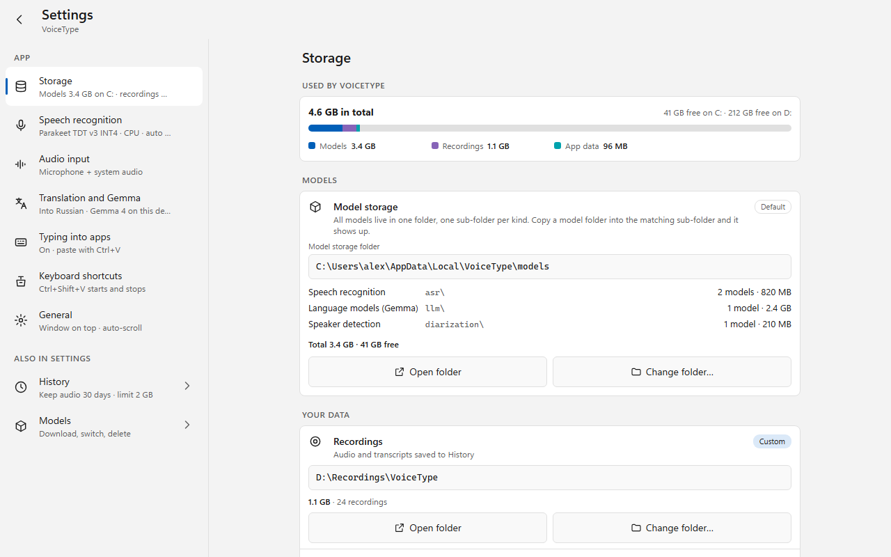
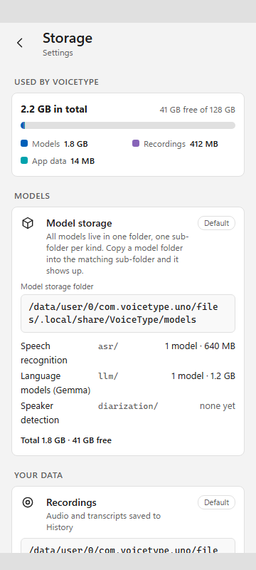

# VoiceType.Uno — настройки приложения

Статус: **реализовано** (2026-10-13) в `apps/VoiceType.Uno`; отличия от макета — в [§8](#8-реализация-и-отличия-от-макета).
Область: `apps/VoiceType.Uno` — головы `net10.0-android`, `net10.0-desktop` (Skia), `net10.0-windows10.0.26100` (WinUI 3).
Продолжает [мобильный редизайн](../voicetype-uno-mobile/README.md) (сетка, брейкпоинты, безопасные зоны, правило 44×44) и
[историю записей](../voicetype-uno-history/README.md) (страница Settings › History, анатомия строк и карточек).
Учитывает коммит `7927985` «one model storage root with asr/llm/diarization folders» ([§12 мобильного дизайна](../voicetype-uno-mobile/README.md)):
хранилище моделей здесь **не переизобретается**, макет повторяет его поведение и тексты.

| Файл | Что это |
|---|---|
| [mockup.html](mockup.html) | Интерактивный макет: список разделов, страницы Storage, Speech recognition, Audio input, Translation and Gemma, Typing into apps, Keyboard shortcuts, General; диалог переноса папки. Параметры описаны в шапке файла |
| [frame.html](frame.html) | Обёртка с точным viewport (копия из `voicetype-uno-history`) |
| [render.ps1](render.ps1) | Рендер 35 сценариев в headless Edge и проверка раскладки (`-Only <подстрока>`) |
| [layout-check.json](layout-check.json) | Отчёт последней проверки: **35/35 OK** |
| [screenshots/](screenshots/) | Скриншоты всех сценариев |

---

## 1. Задача

1. У настроек нет своих экранов: сейчас это один `ContentDialog`. Нужен полноценный дизайн для телефона и десктопа.
2. **Где лежат модели и данные, должно быть видно в настройках, и эти места должны меняться оттуда же.**

## 2. Что есть сейчас

[SettingsDialog.xaml](../../../apps/VoiceType.Uno/src/VoiceType.Uno/Presentation/SettingsDialog.xaml) после `7927985`:

| Проблема | Последствие |
|---|---|
| `ContentDialog` с `ScrollViewer MaxHeight="620"`: шесть групп и около 30 контролов в одной колонке | На телефоне это диалог поверх диалога, длинная прокрутка, нет системного Back; из настроек нельзя открыть второй диалог (поэтому `OpenModelManagerRequested` закрывает окно) |
| Сырые значения в списках: `cpu`, `webgpu:hp`, `webgpu:lp`, `follow_config`, `native`/`http`, `cpu`/`gpu` | Пользователь не знает, что выбирает |
| Горячие клавиши, вставка текста, «поверх окон» показаны на Android | Там они не работают |
| Хранилище моделей уже есть (блок «Model storage»: корень, `asr/`, `llm/`, `diarization/`, итог, Open folder, Change folder…), но живёт в трёх местах: диалог настроек (своя вёрстка с `TextBox`), Settings › History, страница Models | Нет одного места, где видно **всё**, что приложение хранит |
| `AppSettings.SessionsPath` (папка записей) существует, но в UI её нет | Записи можно перенести только правкой `settings.json` |
| Корень данных `AppPaths.DataRoot` (`settings.json`, `chats/`, `jobs/`, `errors.log`, `host.log`, `translation.log`) нигде не показан и не настраивается (кроме DEBUG-переменной `VOICETYPE_DATA_ROOT`) | Пользователь не знает, где его чаты и настройки |

## 3. Решения

**3.1 Страница, а не диалог.** Settings открывается из бокового меню через `Frame.Navigate(typeof(SettingsPage))`, как Models, History и Queue.

- **< 840 px** (телефон, узкое окно): сначала список разделов (хаб) с подписью текущих значений, тап открывает раздел; стрелка назад и системный Back возвращают к хабу, со хаба — на главный экран.
- **≥ 840 px**: две панели — список 300 px слева, раздел справа (до 720 px по центру). По умолчанию открыт Storage.
- Сделано по образцу Windows 11 Settings и Android Settings: один уровень вложенности, без вкладок.

**3.2 Изменения применяются сразу**, без Save/Cancel, как на странице Settings › History: каждый контрол пишет свой ключ через `SettingsStore`. Тяжёлые изменения (модель, compute) идут через существующий `MainViewModel.ApplySettingsAsync` и перезагружают модель; во время записи изменение ждёт Stop (подпись под группой Compute). Перенос папок — единственное, что спрашивает подтверждение: только он трогает файлы.

**3.3 Разделы** (на Android скрыты помеченные *):

| Раздел | Содержимое | Ключи `AppSettings` |
|---|---|---|
| **Storage** | Сводка занятого места; Model storage; Recordings; App data | `ModelsRootPath`, `PendingModelsRoot`, `ModelStorageNote`, `SessionsPath`, новый указатель корня данных (§4.4) |
| **Speech recognition** | Модель в работе → страница Models; язык; Skip silence (VAD); Compute (радио с понятными названиями); Advanced: repetition penalty (с 2026-10-22 без эффекта: ни одна модель его не читает, переключатель сохранён ради старых настроек, подпись в UI это говорит) | `SelectedModel`, `Language`, `UseVad`, `ExecutionProvider`, `RepetitionPenalty` |
| **Audio input** | Microphone / System audio / Microphone + system audio с пояснениями; на Android только микрофон, System audio недоступен с объяснением | `AudioSource` |
| **Translation and Gemma** | Translate while recording; язык; движок On this device / Local server; модель Gemma → Models; CPU/GPU; адрес сервера (только для Local server); доп. инструкции | `TranslationEnabled`, `TranslationTargetLanguage`, `TranslationBackend`, `TranslationComputeBackend`, `TranslationServerUrl`, `TranslationSystemPrompt` |
| **Typing into apps*** | Type into other apps; Stop when focus moves; Paste shortcut (радио) | `IsTextInjectionEnabled`, `DisableInjectionOnFocusChange` (ключ есть, но Uno его не читает: переключатель показывать только вместе с реализацией), `PasteChord` |
| **Keyboard shortcuts*** | Три поля-рекордера с клавишами-чипами; ошибка регистрации показывается в строке и баннером | `ToggleHotkey`, `MuteHotkey`, `InjectTextHotkey` |
| **General** | Follow new text; Start when the model is ready; Keep window on top*; Clear transcript on model change; Reset settings to defaults | `IsAutoScrollEnabled`, `AutoStartRecognition`, `AlwaysOnTop`, `ClearTextOnModelOrSessionChange` |
| *Also in Settings* | History → существующая Settings › History; Models → страница Models | — |

Значения в UI против значений в настройках:

| Показываем | Пишем |
|---|---|
| Processor (CPU) · Recommended | `cpu` |
| Graphics card — performance / power saving | `webgpu:hp` / `webgpu:lp` |
| As set by the model | `follow_config` |
| On this device / Local server | `native` / `http` |
| Processor / Graphics card (Gemma) | `cpu` / `gpu` |
| Microphone / System audio / Microphone + system audio | `Mic` / `Loopback` / `Mix` |

## 4. Storage

Порядок сверху вниз: **сводка → Models → Your data (Recordings, App data)**. Каждая папка — карточка одной анатомии: заголовок и что внутри, бейдж `Default`/`Custom`, **полный путь** моноширинным шрифтом (переносится, никогда не обрезается многоточием — это проверяет `render.ps1`), размер, заметка о состоянии, две кнопки равной ширины `Open folder` · `Change folder…`.

### 4.1 Сводка

Полоса из трёх сегментов (Models, Recordings, App data) поверх свободного места, итог и свободное место по каждому диску, где что-то лежит (`41 GB free on C: · 212 GB free on D:`). Считается вне UI-потока (`ModelStorageScanner`, `HistoryUiStorage.Measure`, `ModelStorage.SizeOf`).

### 4.2 Model storage — без изменений поведения

Карточка — это существующий `ModelStorageBlock`, тексты из `ModelStorageText`: «All models live in one folder, one sub-folder per kind…», подпись «Model storage folder», корень, строки `Speech recognition · asr/ · 2 models · 820 MB`, `Language models (Gemma) · llm/ …`, `Speaker detection · diarization/ … | none yet`, `Total 3.4 GB · 41 GB free`.

Смена папки — как в `ModelStorageUi.ChangeFolderAsync`:

1. `Change folder…` → системный выбор папки (`ExportDialog.PickFolderAsync`).
2. Если в старой папке есть модели — вопрос «Move models to the new folder?»:
   - тот же диск: `Cancel` · `Keep old location` · **`Move on restart`** ([desktop-models-move](screenshots/desktop-models-move.png));
   - другой диск: `Cancel` · **`Keep old location`**; текст объясняет, что модели между дисками автоматически не копируются ([desktop-models-move-other-drive](screenshots/desktop-models-move-other-drive.png)).
3. `Move on restart` пишет `PendingModelsRoot`: карточка показывает «Models will move to D:\Models when the app restarts.» ([desktop-models-pending](screenshots/desktop-models-pending.png)). Новое в дизайне — две кнопки в заметке: `Restart now` и `Don't move` (очищает `PendingModelsRoot`).
4. Если перенос при старте не удался — `ModelStorageNote` из `ModelStorageText.MoveIncompleteNote` жёлтой заметкой ([desktop-models-incomplete](screenshots/desktop-models-incomplete.png)).

Изменение относительно `7927985`: в **диалоге** настроек блок со своим `TextBox` уходит вместе с диалогом. На Settings › History и на странице Models остаётся тот же `ModelStorageBlock`: это один контрол, а главное его место теперь Settings › Storage.

### 4.3 Recordings — новое

Путь из `SessionsPath` (пусто = `<DataRoot>/sessions`), размер и число записей, строка-ссылка `Retention and limits` → Settings › History (сроки хранения и лимит остаются там). Смена — тем же сценарием, что и у моделей, и с той же гарантией (только переименование на том же диске, при старте, без перезаписи и удаления): «Move recordings to the new folder?» `Cancel` · `Keep old location` · `Move on restart`. При `Keep old location` старые записи остаются в старой папке и пропадают из History, пока не вернуть папку, — так и написано в диалоге. `RecordingStore` создаётся один раз при старте, поэтому новая папка всегда начинает работать после перезапуска.

Для реализации обобщить `ModelStorageMigrator.MoveRoot`/`ApplyRootChoice` (или добавить `RecordingStorageMigrator` с тем же контрактом и `PendingSessionsPath`).

### 4.4 App data — новое

Путь `AppPaths.DataRoot`, размер без моделей и записей, список содержимого (`settings.json`, `chats\`, `jobs\queue.json`, `*.log`). Смена: «Move app data to the new folder?» `Cancel` · `Move on restart` (без «Keep»: настройки без данных бессмысленны).

`settings.json` лежит внутри корня данных, поэтому выбор корня нельзя хранить в нём. Предложение: однострочный файл-указатель `data-location.txt` в **корне по умолчанию** (`%LOCALAPPDATA%\VoiceType`, `~/.local/share/VoiceType`). `AppPaths.ResolveDataRoot` читает его первым делом; если папка недоступна — работает с корнем по умолчанию и показывает заметку на карточке. DEBUG-переменная `VOICETYPE_DATA_ROOT` остаётся приоритетнее.

Модели и записи в своих папках при переносе данных не трогаются. Если они лежат внутри корня по умолчанию (`models/`, `sessions/`), перед переносом их путь фиксируется в `ModelsRootPath`/`SessionsPath`, чтобы они не «потерялись».

### 4.5 Android

Как в `ModelStorageBlock`: кнопок `Open folder`/`Change folder…` нет — всё лежит в приватной памяти приложения, файлового менеджера и выбора папки нет. Пути показаны для поддержки и выделяются для копирования. Подпись внизу: всё остаётся на телефоне и удаляется вместе с приложением. Хранение моделей на SD-карте (`getExternalFilesDirs`) — возможное продолжение, в этот дизайн не входит.

## 5. Сценарии и проверка

`render.ps1` рендерит 35 сценариев: Android 360×800, 320×568, 800×360, планшет 800×1280, десктоп 1280×800 (светлая и тёмная тема), минимальное окно 480×560. Для каждого проверяется:

1. все интерактивные элементы внутри безопасной зоны (или внутри прокручиваемой панели, которая внутри неё);
2. цель касания ≥ 44×44;
3. элементы не перекрываются;
4. подписи кнопок не обрезаны;
5. **пути не обрезаны и не шире карточки**;
6. у раздела остаётся область чтения ≥ 96 px (≥ 72 px в коротком ландшафте).

Ключевые скриншоты:

| | |
|---|---|
| Хаб на телефоне | [phone-hub](screenshots/phone-hub.png), [small-hub](screenshots/small-hub.png), [landscape-hub](screenshots/landscape-hub.png) |
| Storage | [desktop-storage](screenshots/desktop-storage.png), [desktop-dark-storage](screenshots/desktop-dark-storage.png), [phone-storage](screenshots/phone-storage.png), [small-storage](screenshots/small-storage.png), [tablet-storage](screenshots/tablet-storage.png) |
| Перенос | [desktop-models-move](screenshots/desktop-models-move.png), [desktop-models-move-other-drive](screenshots/desktop-models-move-other-drive.png), [desktop-recordings-move](screenshots/desktop-recordings-move.png), [desktop-data-move](screenshots/desktop-data-move.png), [desktop-min-move-nested](screenshots/desktop-min-move-nested.png) |
| Состояния | [desktop-models-pending](screenshots/desktop-models-pending.png), [desktop-models-incomplete](screenshots/desktop-models-incomplete.png), [desktop-data-pending](screenshots/desktop-data-pending.png) |
| Остальные разделы | [desktop-speech](screenshots/desktop-speech.png), [desktop-audio](screenshots/desktop-audio.png), [desktop-translation](screenshots/desktop-translation.png), [desktop-translation-server](screenshots/desktop-translation-server.png), [desktop-typing](screenshots/desktop-typing.png), [desktop-hotkeys](screenshots/desktop-hotkeys.png), [desktop-hotkeys-conflict](screenshots/desktop-hotkeys-conflict.png), [desktop-general](screenshots/desktop-general.png), [phone-translation-keyboard](screenshots/phone-translation-keyboard.png) |

Это проверка **макета**, а не приложения. После реализации добавить сценарии Settings в `../voicetype-uno-mobile/uia-layout-check.ps1` и `app-screenshots.ps1`.

## 6. План реализации

1. `SettingsPage` (хаб + раздел, `VisualState` Wide ≥ 840) и пункт меню вместо `SettingsDialog`; стили строк взять из `HistoryStyles` (`HistoryCardStyle`, `HistorySwitchStyle`, …). Логику горячих клавиш перенести из `SettingsDialog.xaml.cs`.
2. Storage: сводка и `ModelStorageBlock` как есть; диалогу переноса добавить `Don't move` в заметку о `PendingModelsRoot`.
3. Recordings: UI для `SessionsPath` + перенос при старте (обобщение `ModelStorageMigrator`).
4. App data: указатель `data-location.txt` в `AppPaths`, перенос при старте, фиксация путей моделей и записей.
5. Тексты и сопоставление значений (§3.3) — в `VoiceType.Uno.Core` (`SettingsText`), с тестами в `VoiceType.Uno.Tests`.

## 7. Открытые вопросы

- **Модели на другой диск.** Сейчас не копируются намеренно (много ГБ, долго). Нужно ли копирование с прогрессом и отменой как явное действие? В макете его нет — он следует реализации.
- **`Restart now`** на десктопе: перезапуск процесса (`Environment.ProcessPath` + выход). На Android перезапуск не нужен: там папки не меняются.
- **Linux (Skia)**: системный выбор папки через портал — проверить, что `PickFolderAsync` работает под Wayland. **[не проверено]**
- Пути Android в макете иллюстративные: реальный `ApplicationId` — `com.companyname.voicetype-uno`.

---

## 8. Реализация и отличия от макета

Код: `Presentation/Settings/` (страница и разделы, строятся в коде из `SettingsRows`), чистая логика и тексты: `VoiceType.Uno.Core/Services/Settings/`
(`SettingsText`, `StorageFolderText`, `StorageOverview`, `HotkeyText`, `FolderMover`, `RecordingStorageMigrator`, `DataLocation`,
`DeferredSettingsApplier`), тесты: `tests/VoiceType.Uno.Tests/Settings/`. `SettingsDialog` и `SettingsViewModel` удалены.
Проверка запущенного приложения: `../voicetype-uno-mobile/uia-layout-check.ps1 -Scenario settings-<раздел> -Seed -ScrollSweep`
(отчёт: [uia-layout-check.json](uia-layout-check.json)), снимки: [app-screenshots/](app-screenshots/).

Отличия и решения:

- **Перенос записей и данных "всё или ничего".** Если часть не перенеслась (занято, имя уже есть), уже перенесённое возвращается
  (`FolderMover.Revert`): приложение читает одну папку, половина в новой скрыла бы чаты или записи. Модели по-прежнему могут переехать частично (как в `7927985`).
- **App data на другой диск копируется** (с проверкой размера; исходник удаляется только после полного копирования, при неудаче копия откатывается):
  данных мало, а типичный сценарий: вынести их с системного диска. Модели и записи между дисками по-прежнему не копируются.
- **Указатель корня данных**: `data-location.txt` и `data-location.pending.txt` в корне по умолчанию. В DEBUG с `VOICETYPE_DATA_ROOT`
  указатели лежат в песочнице, перенос на старте пропускается (корень фиксирован), так что перенос проверяется только до перезапуска (запуск после переноса покрыт тестами `DataLocation`).
- **Recordings, "Keep old location"**: `RecordingStore` открывается один раз, поэтому на карточке заметка "New recordings will be saved to ... after the app restarts" с `Restart now`.
- **Вопрос о переносе: кнопки внутри содержимого диалога**, в столбик на узком окне (три подписи не помещаются в штатный ряд `ContentDialog` при 360 px).
  Для моделей тот же код (`StorageFolderUi.AskAsync`); папка внутри текущей отклоняется диалогом "Choose another...".
- **Translate into**: список языков плюс пункт "Other..." с полем для кода или названия (в макете только список; без него пропал бы ввод вроде Belarusian).
- **Typing**: "Stop when focus moves" не показан (Uno не читает `DisableInjectionOnFocusChange`). Подпись "clipboard is restored" заменена на "the phrase stays on the clipboard": инжектор буфер не восстанавливает.
- **Compute**: смена CPU/GPU теперь перезагружает модель (раньше провайдер действовал только при следующей загрузке); во время записи ждёт Stop
  (`DeferredSettingsApplier`, подпись под группой). Строка "model loaded in 1.8 s" не показана (нет данных).
- **Горячие клавиши**: пока поле слушает, глобальные хоткеи сняты (иначе зарегистрированная комбинация запускала бы действие); нужен Ctrl, Alt или Win;
  дубликат и клавиши без имени отклоняются; ошибка регистрации: в строке ("Not registered") и баннером (`MainViewModel.FailedHotkeys`).
  Повторная регистрация теперь только при смене комбинации и под замком.
- **Reset** сбрасывает опции; папки, выбранные модели, Gemma-compute и History не трогает.
- Шрифт путей: Consolas / Menlo / DejaVu Sans Mono / monospace по платформе; пути переносятся без вставки невидимых символов (копирование чистое), поэтому перенос строки может встать после "C:".
- На широком окне у разделов списка нет шевронов (только у History и Models), как в макете.
- DEBUG-хуки: `VOICETYPE_SETTINGS_PICK=<папка>` вместо системного выбора папки, `VOICETYPE_SETTINGS_ANDROID=1`: раскладка телефона на десктопе.

Не проверено: светлая тема (UIA-прогон шёл в системной тёмной), реальный телефон и эмулятор (раскладка проверена превью на десктопе; головы
`net10.0-android` и `net10.0-windows10.0.26100` собираются), Linux.
